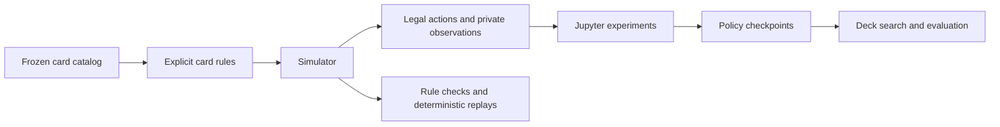

# Hearthstone Learning Lab

A side quest that got out of hand: build a Hearthstone simulator, then use it to explore how a player can learn the game and how decks can evolve.

The interesting part is everything underneath the model. Hearthstone has hidden information, thousands of card interactions, generated cards, persistent effects, and choices that interrupt other choices. This project builds those rules explicitly so that future learning experiments have a game they can trust.

**Work in progress.** The goal is the complete frozen Standard format across all 11 classes. The simulator is still being built, and no learned policy has yet been shown to play well. Training is run manually in Jupyter.

## What is here

- An explicit rules engine with legal actions, private player observations, resumable effects, combat, and deterministic replays.
- A frozen catalog of **1,185 Standard cards**, pinned to patch **36.6.0.251952** and September 18, 2026.
- An experimental learning interface with action features, policy updates, saved checkpoints, and resumable runs.
- A deck-search workflow that compares legal candidate decks using frozen policies and separate evaluation seeds.
- Jupyter notebooks for inspecting the simulator, checking rules, recording games, and running your own experiments.



## Current status

Last updated October 19, 2026. These figures measure written code and internal regression checks. They are **not** independent certification of Hearthstone fidelity.

| Area | Status |
| --- | --- |
| Pinned Standard roots | 1,185 of 1,185 registered in the development candidate |
| Historical minion roots | 3,201 of 3,201 registered; generated effects and recursive pools are still being audited |
| Historical spell roots | 1,414 of 1,442 written; 28 remain (see `docs/engine-audit/historical-generated-spell-backlog-current.json`) |
| Non-training rule regressions | 5,626 checks passing, 0 failures or errors, on source fingerprint `8c2f5c4d0392acca58f53b396f46f44d06f804c5e88e5030fcf9a4d94d1ed1e1` |
| Shared interactions and client fidelity | In progress; known gaps are tracked in `staging/rebased-88/expanded/fidelity_gaps.json` |
| Approximated cards | A short list of cards (for example Bashana, Garona, Zephrys, Whizbang, Elise) use documented approximations; see `staging/rebased-88/APPROXIMATIONS.md` |
| Neural training | A Transformer/PPO trainer and monitoring notebooks exist. A 400-game trial ran without engine crashes after safety changes, but showed no measurable improvement against a hand-written heuristic opponent. Whether it learns at scale is untested. |

**The simulator is not complete and full-format training is not ready.** Unsupported behavior raises an error instead of being silently approximated. See the [candidate status](staging/rebased-88/STATUS.md) for validation evidence and the [completion queue](docs/engine-audit/completion-queue.md) for unfinished work. Older, more detailed progress notes are kept in the [development log](docs/DEVELOPMENT-LOG.md).

## Neural training

Notebooks [15](notebooks/15_transformer_ppo.ipynb) and [16](notebooks/16_long_transformer_training.ipynb) train a 4.76-million-parameter Transformer policy with PPO on four fixed published decks, against frozen copies of itself and archived checkpoints. Notebook 16 adds failure logging, saved game traces, timing, and fixed-opponent evaluation (including one before learning starts).

- Both notebooks start in a safe mode: setup and preflight only. You must set `START_TRAINING = True` yourself.
- Modes in notebook 16: `preflight`, `trial` (400 games), `medium` (2,000 games), `full` (10,000 games).
- The original harness upgrade (`--allow-code-upgrade`) requires an unchanged engine. The separate [`tools/migrate_400_game_checkpoint.py`](tools/migrate_400_game_checkpoint.py) handles only the owner’s exact 400-game checkpoint after the engine repairs; it preserves learning state and starts no games. Checkpoints are not distributed.
- Install with `python -m pip install -e '.[neural,notebook]'`. See [neural training details](docs/NEURAL_TRAINING.md) for resume rules, checks and limitations.
- This is a research baseline, not demonstrated strong play. Beating a random or earlier version of the model is not evidence of expert strength.
- The original linear trainer (notebook 11) and its checkpoints remain separate.

## Try it locally

```sh
git clone https://github.com/mlanning-builds/hearthstone-learning-lab.git
cd hearthstone-learning-lab
make install
make notebook
```

Without Make (including Windows), run `python -m venv .venv`, upgrade pip with `.venv\Scripts\python -m pip install --upgrade pip` on Windows or `.venv/bin/python -m pip install --upgrade pip` on macOS/Linux, then use `.venv\Scripts\python -m pip install -e ".[notebook]"` on Windows or `.venv/bin/python -m pip install -e ".[notebook]"` on macOS/Linux. Preserve the repository layout: the candidate uses a relative link to the shared frozen data. Python 3.9.6 is the currently observed local environment; cross-platform setup remains under review.

Dependencies are declared in `pyproject.toml`. Use an editable installation from the repository checkout; the candidate and frozen data require the existing folder layout. `requirements.txt` forwards to that same configuration for compatibility. Standalone wheel distribution is not supported yet.

Run `make help` for available commands. `make test` checks project tools; `make test-candidate` runs the full non-training rule suite. `make check` checks coverage inventory. `make sim SEEDS=1 MAX_ACTIONS=500` runs bounded random-play validation without updating a model. `make notebook` opens JupyterLab without executing cells. No Make target starts training or deck search.

Start with notebook **09** to inspect coverage and validate random games without learning. Notebook **13** runs the shared-rule checks. When you choose to train, notebook **11** lets you set the budget and start the run yourself. Notebooks **12** and **14** compare and search decks with saved policies.

Training is never started by installation, imports, or continuous integration. Local runs and model files remain under ignored `runs/` directories.

For rule checks only, the candidate checker can use four independent processes:

```sh
cd staging/rebased-88
../../.venv/bin/python ../../tools/check_without_training.py --suite candidate --workers 4
```

The checker excludes training scenarios and binds its receipt to unchanged source. Sequential execution remains the default.

## Explore the code

| Path | Purpose |
| --- | --- |
| [`staging/rebased-88/expanded/`](staging/rebased-88/expanded/) | Current all-class development candidate |
| [`notebooks/`](notebooks/) | Interactive simulator and experiment workflows |
| [`tools/`](tools/) | Validation, recording, training, and deck-search runners |
| [`data/standard/`](data/standard/) | Frozen card catalog and provenance |
| [`docs/engine-audit/`](docs/engine-audit/) | Dependency inventories, reviewed behavior, and unresolved fidelity gaps |
| [`engine/`](engine/) and [`learner/`](learner/) | Preserved original Death Knight experiment |

The candidate folder's name is historical. The older root simulator and notebooks are retained for provenance; use notebooks 09–14 for current candidate work. The [project guide](PROJECT_GUIDE.md) has detailed workflows and experiment boundaries.

## Where this is going

Complete the remaining card effects and generated dependencies, validate shared interactions against independent evidence, and make the simulator easy for other people to use. Then run larger learning and deck-search experiments in Jupyter with explicit budgets and reproducible reports.

Contributions are welcome. Start with [CONTRIBUTING.md](CONTRIBUTING.md) and the [roadmap](docs/ROADMAP.md). Changes should include a meaningful rules scenario and preserve hidden-information boundaries and deterministic replay.

## License and data

Project source code is available under the [MIT license](LICENSE). Frozen third-party card data and game content retain their original rights and are excluded from that source-code license; see [NOTICE](NOTICE). This is an unofficial fan project, with no Blizzard affiliation.

## Explore the code

| Path | Purpose |
| --- | --- |
| [`staging/rebased-88/expanded/`](staging/rebased-88/expanded/) | Current all-class development candidate |
| [`hearthstone_sim/`](hearthstone_sim/) | Public facade and neural training code |
| [`notebooks/`](notebooks/) | Interactive simulator and experiment workflows |
| [`tools/`](tools/) | Validation, recording, training, and deck-search runners |
| [`data/standard/`](data/standard/) | Frozen card catalog and provenance |
| [`docs/engine-audit/`](docs/engine-audit/) | Dependency inventories, reviewed behavior, and unresolved fidelity gaps |
| [`engine/`](engine/) and [`learner/`](learner/) | Preserved original Death Knight experiment |

The candidate folder's name is historical. The older root simulator and notebooks are retained for provenance; use notebooks 09-16 for current work. The [project guide](PROJECT_GUIDE.md) has detailed workflows and experiment boundaries.

## Where this is going

Complete the remaining card effects and generated dependencies, validate shared interactions against independent evidence, and make the simulator easy for other people to use. Then run larger learning and deck-search experiments in Jupyter with explicit budgets and reproducible reports.

Contributions are welcome. Start with [CONTRIBUTING.md](CONTRIBUTING.md) and the [roadmap](docs/ROADMAP.md). Changes should include a meaningful rules scenario and preserve hidden-information boundaries and deterministic replay.

## License and data

Project source code is available under the [MIT license](LICENSE). Frozen third-party card data and game content retain their original rights and are excluded from that source-code license; see [NOTICE](NOTICE). This is an unofficial fan project, with no Blizzard affiliation.
