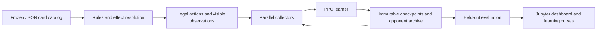

# Hearthstone Learning Lab

A personal research project exploring reinforcement learning in a card game with hidden information, generated cards and interruptible effects. The project combines an explicit Hearthstone rules simulator with resumable PPO self-play and a model-comparison harness.

**Research prototype.** Internal rule checks and observed learning results are not independent certification of game fidelity or evidence of expert-level play. Known approximations and unresolved interactions are documented.

## Engineering focus

- **Rules and information boundaries:** legal-action masks, player-visible observations, ordered effect resolution and resumable choices.
- **Reproducible runs:** frozen card data and deck panels, separate training/evaluation seeds, immutable checkpoints, source fingerprints and explicit compatibility migrations.
- **Training:** a policy/value Transformer with PPO, checkpoint opponents, tactical fixtures and parallel game collection.
- **Evaluation:** fixed opponents, confidence intervals, tactical categories, error accounting and resumable case-level receipts. Failed games are not silently scored as losses.
- **Research comparison:** fresh MLP, bounded-memory GRU and larger Transformer learners compared with a preserved small Transformer, with and without limited combat look-ahead. Equal completed-game budgets; time recorded separately.

## Architecture



| Location | Purpose |
|---|---|
| [`staging/rebased-88/expanded/`](staging/rebased-88/expanded/) | Active all-class simulator; folder name is historical |
| [`hearthstone_sim/neural/`](hearthstone_sim/neural/) | Encoding, Transformer/PPO, collection, evaluation and tactical fixtures |
| [`hearthstone_sim/research/matched_games/`](hearthstone_sim/research/matched_games/) | Architecture comparison, bounded GRU context, combat look-ahead and graphs |
| [`configs/`](configs/) | Experiment configurations; some resume profiles require local artifacts |
| [`tests/`](tests/) and [`staging/rebased-88/tests/`](staging/rebased-88/tests/) | Harness contracts and simulator scenarios |
| [`notebooks/`](notebooks/) | Manually launched experiments; published without outputs |
| [`engine/`](engine/) and [`learner/`](learner/) | Preserved original experiment |

Card metadata lives in JSON; effects are explicit code. This keeps complex timing and generated dependencies reviewable rather than treating card text as an executable specification. The tradeoff is substantial interaction-testing work.

## Current experiments

As of **October 23, 2026**, the local small-Transformer lineage has **19,931 completed training games**. The campaign uses a frozen **176-deck panel across all eleven classes**, including strategy variants and randomized legal decks. Its opponent mix is 60% current self-play, 30% archived models and 10% heuristic.

Notebook 22 prepares an exploratory comparison with three fresh alternatives, each targeting 19,931 completed games. Graph checkpoints occur every 1,000 games and at the final budget. Two-hour resumable sessions bound each launch. The saved Transformer and its search variant are already-trained references, not fresh learning curves. Different training histories and a single seed limit causal conclusions. **The comparison has not completed; no architecture winner is claimed.**

The search variant is a bounded two-ply public-information planner for supported ordinary minion combat, with base-policy fallback. It is not full-game MCTS and does not model unknown secret activation. Coverage and additional decision time must accompany its score.

See [comparison design](docs/research/MATCHED_GAMES_COMPARISON.md), [campaign setup](docs/ALL-CLASS-CAMPAIGN.md) and [validation status](STATUS.md).

## Run locally

Python 3.9.6 is the observed development environment. Preserve the checkout layout: the active candidate uses shared data through a relative link. Standalone wheel distribution is not supported.

```sh
git clone https://github.com/mlanning-builds/hearthstone-learning-lab.git
cd hearthstone-learning-lab
python3 -m venv .venv
.venv/bin/python -m pip install --upgrade pip
.venv/bin/python -m pip install -e '.[neural,notebook,research,dev]'
make neural-preflight
make notebook-neural
```

Notebook 15 is the fresh-run entry point. Notebook 21 is the local campaign resume workflow. Notebook 22 is the model-comparison resume workflow. **Resume notebooks require the matching local checkpoints and frozen deck-panel files; these artifacts are intentionally not distributed.** Installation, imports and CI do not launch training. Read each notebook's start gate before running cells.

On Windows, use `.venv\Scripts\python` in place of `.venv/bin/python`; that platform has not been validated for the full workflow.

## Validation and limitations

```sh
make quality          # staged lint and strict facade typing
make smoke            # bounded non-learning simulator checks
make test             # supporting tool contracts
make test-candidate   # full non-training candidate rule suite
```

The latest destroy-target repair passed **93 targeted non-training checks** and a resume-integrity preflight. This is not a new full-suite pass. Earlier full-suite evidence is tied to its original source fingerprint; see [validation status](STATUS.md).

The pinned catalog targets patch **36.6.0.251952** (September 18, 2026), rather than automatically following the live game. Registered card identities do not establish correct behavior in every interaction. [Known fidelity gaps](staging/rebased-88/expanded/fidelity_gaps.json) and [documented approximations](staging/rebased-88/APPROXIMATIONS.md) remain part of the experimental scope. Tactical quiz success and wins against historical checkpoints do not establish ladder strength.

CI runs lint/type checks, smoke checks and non-training rules. Neural experiments remain owner-launched. Models, live outputs, run receipts, environments and credentials remain outside Git.

## Contributing and license

See [CONTRIBUTING.md](CONTRIBUTING.md) for rule scenarios and information-boundary expectations. Source is [MIT licensed](LICENSE). Third-party game data retains its original rights; see [NOTICE](NOTICE). This is an unofficial fan project with no Blizzard affiliation.
